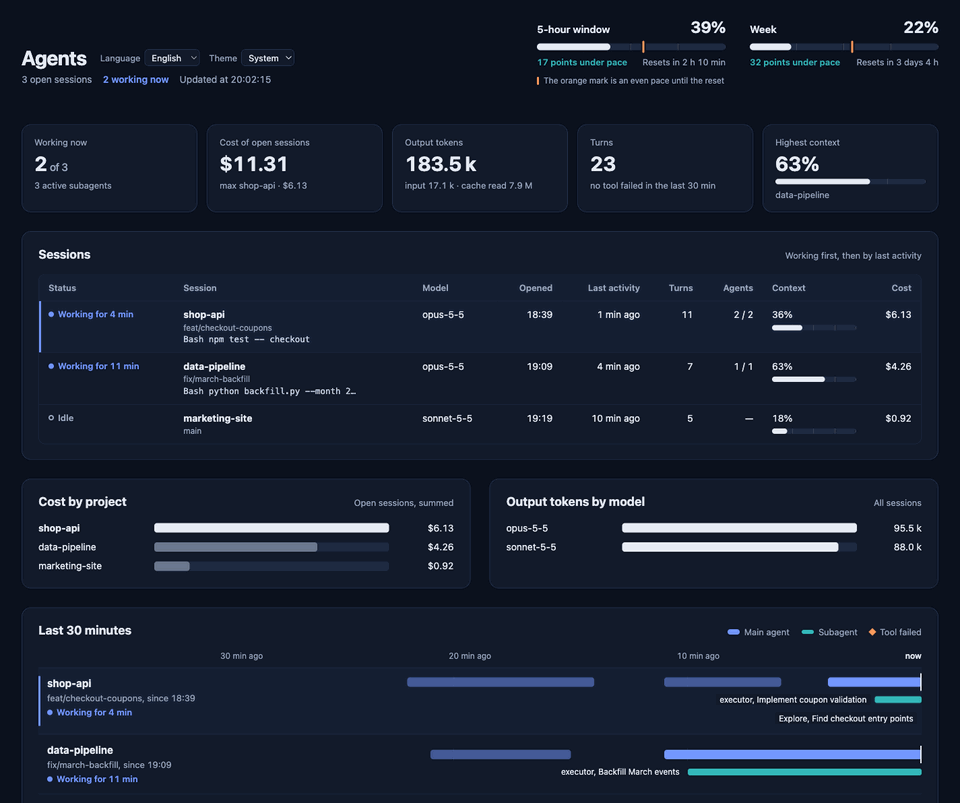
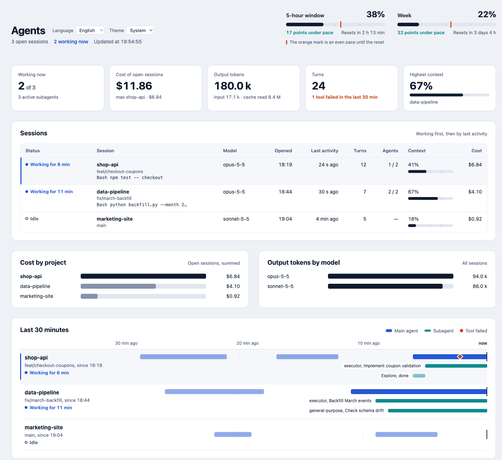
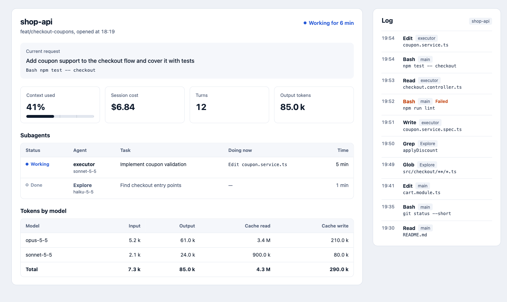

# agent-board

A live board of every Claude Code session running on your machine: what each one is doing right now, the subagents it launched, its context and cost, token usage per model, and how much of your plan's rate limits you have left.

It comes in three views:

- **Web dashboard**: a local page with KPIs, a 30-minute activity timeline, cost per project, tokens per model and a per-session activity log.
- **Pane**: a panel docked inside Claude Code that lists the sessions and opens the detail of the one you pick.
- **Text**: the same board printed in the conversation. It works anywhere, including headless and remote sessions.



<details>
<summary>Dashboard overview, light and dark</summary>

<picture>
  <source media="(prefers-color-scheme: dark)" srcset="docs/overview-dark.png">
  
</picture>

</details>

<details>
<summary>Session detail: current request, subagents, tokens by model and activity log</summary>

<picture>
  <source media="(prefers-color-scheme: dark)" srcset="docs/session-dark.png">
  
</picture>

</details>

<sub>The animation and screenshots use demo data, with time sped up in the animation.</sub>

## Why agent-board?

- **No database, no Docker, no npm install.** Each session writes a small JSON file. The web view only needs Node: it is a single script that uses Node's standard library, starts on demand and stops itself after 30 idle minutes. The pane and text views need nothing.
- **It lives where you work.** Besides the web dashboard, the board opens as a pane inside Claude Code and prints as text, so it also works over SSH and in headless sessions.
- **It shows how much of your plan is left.** The 5-hour and weekly rate limits appear with a pace marker, so you can tell whether you are burning through them too fast.
- **It stays on your machine.** The dashboard listens only on `127.0.0.1`, rejects requests for any other host and loads nothing from the internet.
- **English and Spanish.** The pane, the text view and the dashboard come in both languages.

It is a live view of what is running now. If you need history, session replay or analytics over weeks, a tool backed by a database will serve you better.

## Install

At the prompt of a Claude Code terminal session:

```
/plugin install agent-board --marketplace PedroRozas/agent-board
```

From a shell:

```
claude plugin install agent-board --marketplace PedroRozas/agent-board
```

In the desktop app, where `/plugin` does not run: click **+** next to the prompt box, then **Plugins**, **Add marketplace** with `PedroRozas/agent-board`, then **Add plugin**.

Answer `y` to add the marketplace, then choose a scope. Install it at the **user** scope so every session publishes its state to the board. Sessions that don't run the plugin won't show up.

## Usage

| Command | What it does |
| --- | --- |
| `/agent-board` or `/agent-board web` | Starts the dashboard if it is not running and opens it in your browser |
| `/agent-board panel` | Opens the board as a pane inside Claude Code |
| `/agent-board text` | Prints the board in the conversation |
| `/agent-board <number>` | Prints the detail of session `<number>` from the list |

With the language set to Spanish, the command is `/agentes` and `text` also accepts `texto`.

## Configuration

Open `/config` and look for **agent-board**:

| Option | Default | Description |
| --- | --- | --- |
| `language` | `en` | `en` or `es`. Sets the language of the board, its command and the dashboard's initial language |
| `port` | `4317` | Local port of the web dashboard (1024–65535) |

The dashboard also has its own **Language** and **Theme** (System, Light, Dark) selectors next to the title. Your choice is saved in that browser and wins over the `language` option.

## Remote and headless sessions

When the session runs over SSH, or on Linux without a display, the plugin still starts the dashboard. It does not try to open a browser. Instead it prints the board as text along with the dashboard's URL. To see the dashboard from your own machine, forward the port:

```
ssh -L 4317:127.0.0.1:4317 <server>
```

Then open `http://127.0.0.1:4317` locally.

## Requirements

- Claude Code with plugin hooks support.
- macOS, Linux or Windows. The browser opens with `open` on macOS, `xdg-open` on Linux and the default browser handler on Windows.
- Node.js on your `PATH`, for the web dashboard only. The pane and text views don't need it. On macOS and Linux the dashboard starts from your login shell, so a Node installed through nvm or similar is found. On Windows it starts through PowerShell.

## How it works

Each session running the plugin writes a snapshot of its state every 3 seconds to `~/.claude/agent-board/sessions/<session-id>.json` (`%USERPROFILE%\.claude\agent-board\sessions` on Windows). Every view reads those files:

- A session that stops writing shows as **no signal** after 20 seconds.
- It is hidden after 10 minutes.
- Its file is deleted after 24 hours, or when the session ends.

The dashboard is a small Node server (`dashboard/server.mjs`) bound to `127.0.0.1`. It is never exposed to your network, and it shuts itself down after 30 minutes without requests.

## Privacy

Everything stays on your machine. Keep in mind that the snapshot files are plain JSON in your home directory, and that they include:

- the first 200 characters of each session's latest prompt;
- short summaries of recent tool calls, such as file names and shell commands.

On macOS and Linux, every session sets `~/.claude/agent-board` and its `sessions` folder to mode `700` when it starts, so other users on the machine cannot read them. On Windows the files inherit the permissions of your user profile.

The dashboard uses your system fonts and loads nothing from the internet.

## Development

```
claude plugin validate .
claude plugin test .
```

To try a local copy, start Claude Code with `claude --plugin-dir <path-to-agent-board>`.

## License

MIT. See [LICENSE](LICENSE).
